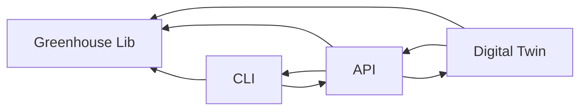

# GreenhouseDT CLI
This is a CLI for interacting with the [GreenhouseDT](https://github.com/sievericcardo/greenhouse-dt-api) project. This was created for SWEN 711, Self Adaptive Software at RIT.

## Project Setup
This project uses [uv](https://docs.astral.sh/uv/) to manage and run python packages. This project is a monorepo for an digital twin and corresponding CLI. THe CLI is a digital version of the physical greenhouse, as we do not have access to the materials necessary to build a physical greenhouse.

### Package Structure

This package is broken into four sub-packages with defined behaviors. 
- The digital twin is the main focus of this repository. It defines the adaptation methods, greenhouse simulation and twin behavior.`
- The API package is a REST api written with Flask that allow clients to interact with and use the digital twin.
- The CLI package is a command line interface that mimicks a physical greenhouse.
- Greenhouse Lib is a library that contains standard models for the project. THis allows the CLI, API and Digital Twin to operate on the same model definitions.



### Running
#### Running the digital twin
```shell
uv run --package digital_twin digital_twin
```

#### Running the command line interface
```shell
uv run --package cli cli
```

#### Running the greenhouse API
```shell
uv run --package api api
```

#### Building the greenhouse library
```shell
uv build --package greenhouse_lib 
```

